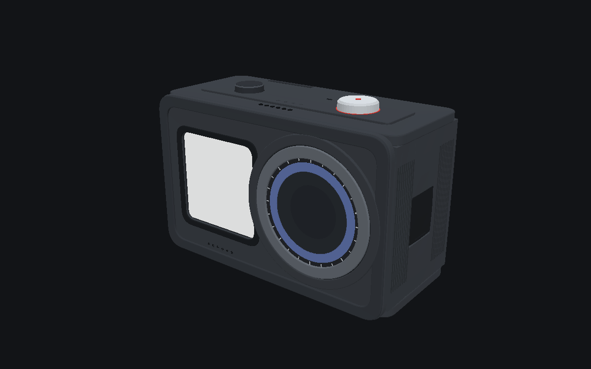
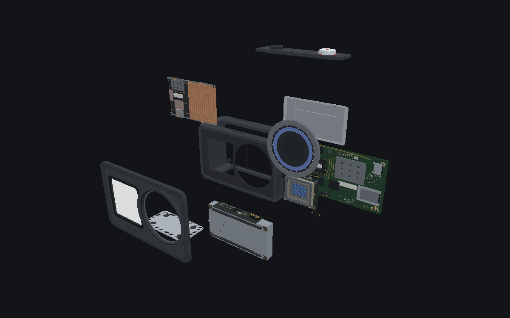

# DJI Osmo Action 4 · 3D 拆解可视化

用 **Three.js 纯代码**还原的大疆 Osmo Action 4 运动相机可点击拆解页：10 个部件、逐层爆炸、点击聚焦、参数标注。
**不依赖任何外部 3D 模型 / 图片 / 字体**，全部几何与贴图由代码实时生成。

成品是**一个 HTML 文件**（约 780 KB），双击即可离线打开，不需要服务器、不需要联网。




> 上图由项目自带的软件光栅器 `tools/render.mjs` 离线渲染（无浏览器、无色差后处理），
> 只为核对几何与构图；实际页面有 PBR 材质、环境反射、辉光与 DOM 标签。

---

## 1. 怎么玩

| 操作 | 效果 |
|---|---|
| 拖拽画面 | 自由旋转视角 |
| 滚轮 / 双指 | 推近拉远 |
| 单击部件 | 聚焦该部件（相机飞行 + 详情面板 + 高亮描边发光） |
| 拖动底部滑杆 | 手动控制拆解进度 0 → 100% |
| 空格 | 自动拆开 / 合拢 |
| `←` `→` | 上一个 / 下一个部件 |
| `0`–`9` | 直接跳到第 n 个部件（0 = 第 10 个） |
| `R` | 复位视角 |
| `E` | 显示 / 隐藏 3D 标签 |

右侧清单可以悬停、点击、按顺序浏览；详情面板里有角色、作用与 4 条关键参数。

## 2. 十个部件

| # | 部件 | 拆解层 | 看点 |
|---|---|---|---|
| 1 | 前面板 `frontcover` | 最外 | CNC 面板、1.4″ 前屏、麦克风孔、螺丝柱 |
| 2 | 镜头模组 `lens` | 光学 | 铝压圈 + 44 齿滚花、三级镜筒、6 片球冠镜片、七叶光圈、对焦线圈 |
| 3 | 图像传感器 `sensor` | 光学 | 1/1.3″ CMOS、陶瓷封装、80 颗微透镜、金线键合、屏蔽罩 |
| 4 | 导热与散热 `heatsink` | 热管理 | 24 片鳍片、3 根铜热管、导热垫、屏蔽罩开孔 |
| 5 | 主板 `mainboard` | 电子 | SoC/BGA、屏蔽盖、SMD 阵列、柔性排线、连接器 |
| 6 | 电池 `battery` | 能源 | 1770 mAh 电芯、BMS 保护板、镍带焊点、拉手胶带 |
| 7 | 后屏 `rearscreen` | 交互 | 2.25″ 触摸屏层序（玻璃→触摸→LCD→中框） |
| 8 | 顶部按键 `topkeys` | 交互 | 快门键录指环、电源/QS 键、进音腔、锅仔片 |
| 9 | 磁吸底座 `mount` | 结构 | 4 颗磁铁、磁吸环、L 形卡爪、释放推钮 |
| 10 | 外壳 `shell` | 结构 | 中空贯通机身、防水结构、防滑纹、卡槽门、密封垫 |

## 3. 技术实现

- **纯代码几何**：所有零件都由 `BoxGeometry / Cylinder / Extrude / Lathe / InstancedMesh` 组合而成，共约 **13.9 万三角面 / 527 个网格**，没有任何外部模型或图片。
- **程序化贴图**：PCB 走线、丝印文字、屏幕 UI、拉丝金属、二维码等用 `CanvasTexture` 现画（`src/engine/detail.js`）。
- **逐层拆解时间轴**：每个部件有独立的 `win = [t0, t1]` 时间窗，全局进度 `P` 扫过时错峰外移，形成"分层展开"而不是一起炸开（`src/data/layout.js`）。
- **相机**：空闲缓慢环绕 + 视差；选中部件时用二次贝塞尔弧线飞过去，并把注视点锁在当前拆解位置（避免拆到一半镜头跑偏）。
- **发光高亮**：选中时对材质做一次浅克隆并加 `emissive`，退出时还原，不影响共享材质（`glowCache`）。
- **DOM 标签**：每帧把部件世界坐标投影成屏幕坐标，标签跟着模型走。
- **单文件交付**：`esbuild` 把 JS 与 CSS 打包内联进 HTML，`three` 指向本地 `vendor/`，产物零外部请求。

## 4. 目录结构

```
dji-action4-teardown/
├─ index.html            # 页面骨架（开发模式引 dev/bundle.*，构建时内联）
├─ tokens.css / ui.css   # 设计变量与界面样式
├─ build.mjs             # 构建脚本：node build.mjs → dist/单文件
├─ src/
│  ├─ main.js            # 集成层：装配 / 进度 / 交互 / 界面
│  ├─ engine/            # kit(材质工具) detail(程序化贴图) stage(场景) camera(相机)
│  ├─ parts/             # 10 个部件模块，各自 build(env) 返回 Group
│  └─ data/              # layout.js(坐标/拆解/机位) copy.js(中文文案)
├─ tools/
│  ├─ probe.mjs          # 几何自检：尺寸越界 / 面数预算 / 穿插 / 外部资源
│  ├─ render.mjs         # 无浏览器的软件光栅预览（z-buffer，出 PNG）
│  └─ serve.mjs          # 开发静态服务
├─ vendor/three.module.js
├─ docs/                 # 预览图
└─ dist/DJI-Action4-拆解.html   ← 成品，双击即开
```

## 5. 本地开发

```bash
npm install          # 只装 esbuild
npm run dev          # http://127.0.0.1:5181/index.html
npm run probe        # 几何自检（10 件全绿才提交）
npm run build        # 生成 dist/DJI-Action4-拆解.html
npm run render -- --p 1 --shot open   # 离线出预览图 tools/out/
```

`index.html?part=lens&t=1` 可以单看某个部件；`node tools/probe.mjs lens` 只查一件。

## 6. 说明与免责

- 本项目是**依据公开资料与官方外观做的艺术化复刻**，不是官方 CAD 数据：部件外形、内部布局、芯片型号均为合理推测的近似表达，不代表真机结构。
- 参数（1/1.3″ CMOS、f/2.8、155° 视角、4K/120、1770 mAh、18 m 防水、145 g、70.5×44.2×32.8 mm）来自公开规格，可能随固件与批次变化。
- "DJI"、"Osmo Action" 为深圳市大疆创新科技有限公司的商标，本项目与其无关联，仅作技术演示。

## 7. 许可

MIT License，见 [LICENSE](LICENSE)。